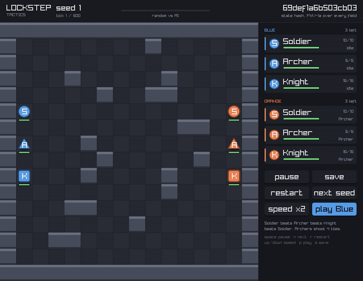

# lockstep-tactics

[](https://github.com/RizgarOzan/lockstep-tactics/actions/workflows/determinism.yml)

**[▶ Play it in the browser](https://rizgarozan.github.io/lockstep-tactics/)**: the
simulation compiled to WebAssembly. Watch the AI beat a random player, take
Blue yourself, or open a room and play a friend in another browser, with the
live state hash on screen and a *save* button that writes a replay any
machine can verify.

<p align="center">
  
</p>
<p align="center"><sub>Seed 1 at 2× speed, random Blue against the AI, rendered headless by <code>viewer --capture</code>.</sub></p>

A small tick-based tactics simulation in C++20, written to be **bit-identical
across compilers**: the same inputs must give the same state hash under MSVC
x64, Apple clang on arm64 and WebAssembly, on every tick. That property is what lockstep
multiplayer and replays stand on, and it breaks in quiet ways — floats,
unordered containers, `std::sort` on equal keys, `size_t` width, signed
overflow.

> **Status: playable.** Two players, a 16×16 map, a Soldier, an Archer and a
> Knight each; move and attack orders, hit rolls, cooldowns, simultaneous
> damage, and a matchup triangle (Soldier beats Archer beats Knight beats
> Soldier), shortest-path movement, walls as cover and one unit per tile. A
> deterministic AI plays Orange with one focus for the whole side, a hold for
> slow teammates and Archers that shoot and step back; it beats the random
> player in 995 of 1,000 matches and a focus-fire script 738 to 257
> ([note 11](docs/notes/11-paths-cover-and-bodies.md) has it against five
> opponents). You can play Blue against it in the browser, or play
> another person: two browsers run the match in lockstep over a WebRTC data
> channel, three ticks ahead, comparing hashes as they go. In 1,000
> seeded matches of 600 ticks, MSVC x64, Apple clang arm64 and WebAssembly
> reach the same final hash in every one (CI checks this on each push). A
> replay recorded under MSVC also verifies tick by tick under WebAssembly,
> and when two runs disagree the `lockstep` tool names the first tick and
> the field: it located 100 of 100 injected desyncs exactly.

## What makes it deterministic

Each rule has a short note on why it exists. Six of them (fixed-point
rounding, the PCG32 output, the command sort, simultaneous damage, hash
coverage, the bisector's tick) were broken on purpose once to confirm a test
catches it.

| Rule | Why | Note |
|---|---|---|
| Q16.16 fixed-point, never `float` | compilers may fuse or reorder float maths | [01](docs/notes/01-fixed-point.md) |
| Own PCG32 and bounded draw, not `<random>` | `std::*_distribution` differs between STLs | [02](docs/notes/02-rng.md) |
| Units in a vector sorted by id | `unordered_map` iteration order differs | [03](docs/notes/03-map-and-units.md) |
| One random draw per tile in map generation | RNG position must not depend on outcomes | [03](docs/notes/03-map-and-units.md) |
| Commands sorted on every field | arrival order differs between machines | [04](docs/notes/04-commands-and-combat.md) |
| Damage applied after everyone acts | unit ids must not decide who dies | [04](docs/notes/04-commands-and-combat.md) |
| The hash test edits each field in turn | a field missing from the hash is an invisible desync | [03](docs/notes/03-map-and-units.md) |
| Hash, dump and diff walk one field list | a debug tool that reads other fields than the hash misses desyncs | [05](docs/notes/05-replays-and-the-bisector.md) |
| Float only where nothing reads it back (rendering) | smooth motion without touching the simulated state | [07](docs/notes/07-viewer.md) |
| A click becomes a `Command` for the next tick | input enters the state only through `step()` | [08](docs/notes/08-player.md) |
| The AI uses integers only and emits only changes | its commands are in the replay too | [09](docs/notes/09-ai-and-matchups.md) |
| Online, a tick runs when both sides' orders for it are in | orders scheduled three ticks ahead; frames carry the last hash | [10](docs/notes/10-two-browsers.md) |
| Paths by BFS with a fixed tie order; cover by integer Bresenham | the same tile and the same shot on every machine | [11](docs/notes/11-paths-cover-and-bodies.md) |
| Pockets filled by a flood fill that draws no random numbers | map generation keeps one draw per tile | [11](docs/notes/11-paths-cover-and-bodies.md) |
| Every unit decides from the tick's starting positions | acting first within a tick buys nothing | [13](docs/notes/13-fair-fast-and-rollback.md) |
| Rollback confirms a tick only with both sides' orders | the replay holds confirmed ticks, never guesses | [13](docs/notes/13-fair-fast-and-rollback.md) |

Three of these rules were also broken in a whole build (`-DLOCKSTEP_RISKY=unordered|float|size_t`,
[note 06](docs/notes/06-breaking-it-on-purpose.md)), 1,000 matches each:

| Broken build | MSVC | gcc | WebAssembly |
|---|---|---|---|
| units act in `unordered_map` order | 0 differ | 995 differ | 996 differ |
| movement in `float` | same on all three | | |
| `float` + gcc `-mfma -ffp-contract=fast` | | 4 differ | |
| a `size_t` in the state hash | same as gcc | | 1000 differ, from tick 1 |

(Re-measured after the simulation changes in note 11; the first round, on the
simpler simulation, read 881, 860 and 12.)

MSVC's `unordered_map` happened to iterate in id order here, so that bug only
shows on the other two compilers. Float was deterministic on all three targets
until one compiler flag let gcc fuse multiply-adds; the fixed-point build
under the same flag did not change. A `size_t` in the hash is invisible
between two 64-bit compilers and breaks every single tick against wasm32.

Write-up of these two experiments:
[English](docs/blog/2026-10-12-worked-on-msvc-en.md) ·
[Türkçe](docs/blog/2026-10-12-worked-on-msvc-tr.md).

## Why not …

- **… just use `float` and test on one machine?** That is what most hobby
  lockstep games do, and it is exactly the bug this repo measures: the
  `unordered_map` build passes every test on MSVC and desyncs on two other
  compilers. The point is not that fixed-point is clever; it is that the
  claim "bit-identical" is checked on every push, across compilers, with
  replays that any machine can verify.
- **… a smarter AI?** The one here (note 09) is a few integer rules: one
  focus for the side, fight what is in reach, wait for the slow teammate,
  Archers shoot and step back. Note 11 shows what measuring it against
  scripted opponents found and fixed, most of it in the simulation rather
  than the AI (no paths, no cover, no bodies). It still has no look-ahead
  and no retreat; its job is to make the demo a game and to put a second
  order source into the replays.
- **… an engine's netcode (Unity Netcode, Godot, Photon)?** Those give you
  state synchronisation; they do not give you a simulation that is the same
  everywhere, and they cannot be dropped into a browser tab. This is the
  layer underneath, small enough to read in an afternoon (about 700 lines of
  C++ for the simulation and the tools).
- **… GGPO or a rollback library?** Rollback assumes determinism and solves
  latency on top of it. The hard part they leave to you, "is my simulation
  actually deterministic, and where did it stop being so", is what the replay
  format and the bisector here answer.

## How fast

`bench` times `step()` on recorded orders and leaves the input generator
out. Before pathfinding a tick cost 64–89 ns on this laptop across gcc,
MSVC and WebAssembly, after the three per-tick heap allocations were
removed (it was 1.8–2.7× slower before that, and until then WebAssembly
was the fastest build, most likely because its allocator is single-threaded).
The shortest-path walk in [note 11](docs/notes/11-paths-cover-and-bodies.md)
is A* with a bucketed open list, run per moving unit whose straight line
is blocked, and it dominates: about 1.0 µs per tick under gcc (1.85 with
the first breadth-first version), 600 ticks in well under a millisecond,
fine for ten ticks a second and still the obvious next thing to optimise.
Method, numbers and the fix: [note 12](docs/notes/12-benchmark.md). The
benchmark does not run in CI on purpose; shared runners are not a clock.

## How the check works

```
tools/replay.cpp  ── seed → random Blue vs AI Orange → step() × 600 → hash()   (one line per seed)
        │
        ├── windows-latest, MSVC x64          → msvc.txt
        ├── macos-latest, Apple clang arm64   → clang.txt
        └── ubuntu-latest, Emscripten         → wasm.txt (run under Node)
                                                   │
                              compare job: diff msvc.txt clang.txt; diff msvc.txt wasm.txt

tools/lockstep.cpp ── MSVC job: record a 600-tick replay (commands + hash per tick)
                      wasm job: verify it, failing on the first tick that differs
tools/arena.cpp    ── MSVC job: 1,000 matches, prints who won
```

Finding a desync by hand:

```bash
lockstep verify match.txt          # on the machine that disagrees: "desync at tick 125"
lockstep dump match.txt 125 > a.txt  # on both machines, then diff a.txt b.txt
```

The state hash is FNV-1a over fixed-width integers in little-endian byte
order (`core/include/lockstep/hash.hpp`), so the hash itself cannot differ
between a 64-bit and a 32-bit target.

## Build

Needs CMake ≥ 3.25 and a C++20 compiler; doctest is fetched by CMake.

```bash
cmake -S . -B build -G Ninja -DCMAKE_BUILD_TYPE=Release
cmake --build build
ctest --test-dir build
build/replay 1000 600     # one hash per seed, what CI diffs between compilers
build/arena 1000 600      # AI vs random: who won
build/bench 200 600 50    # ns per tick: min, median, max over 50 repeats
```

WebAssembly, with the Emscripten SDK active:

```bash
emcmake cmake -S . -B build-wasm -DCMAKE_BUILD_TYPE=Release
cmake --build build-wasm
node build-wasm/replay.js 1000 600
```

The viewer is opt-in because it fetches raylib:

```bash
cmake -S . -B build-viewer -DLOCKSTEP_VIEWER=ON && cmake --build build-viewer --target viewer
emcmake cmake -S . -B build-web -DLOCKSTEP_VIEWER=ON && cmake --build build-web --target viewer   # index.html
```

In the viewer: space pauses, N is the next seed, R restarts, up/down change
the speed, P switches between watching and playing Blue, S saves the replay
(a download in the browser). Playing: click a unit or its card, then a tile
or an enemy.

To play a friend, one browser presses *Create a room* and reads out the
six-letter code, the other types it and presses *Join*. Ticking *rollback*
before creating the room removes the input delay: orders run at once and
the ticks since are re-run when the other side's arrive
([note 13](docs/notes/13-fair-fast-and-rollback.md)). The handshake goes
through a public [ntfy.sh](https://ntfy.sh) topic (`?relay=` points the page
at another ntfy server); after that the two browsers exchange lockstep
frames directly over WebRTC ([note 10](docs/notes/10-two-browsers.md)). The
same `lockstep::Lockstep` class, with no sockets in it, is what
`tests/test_net.cpp` runs two of against each other.

## Roadmap

1. ~~One map, three unit types, fixed-point movement and combat, fixed timestep.~~ Done.
2. ~~Replay files: record inputs, play them back, check the hash every tick.~~ Done.
3. ~~A desync bisector that names the first differing tick and field.~~ Done.
4. ~~Deliberately risky code paths to prove the checks catch what they claim to.~~
   Done for the simulation ([note 06](docs/notes/06-breaking-it-on-purpose.md)); render-side
   float interpolation comes with rendering.
5. ~~raylib rendering, playable in the browser.~~ Done ([note 07](docs/notes/07-viewer.md)).
6. ~~Touch controls for the browser page, and a real player instead of random orders.~~ Done ([note 08](docs/notes/08-player.md)).
7. ~~An opponent worth playing, and a reason to pick one unit over another.~~ Done: the AI and the matchup triangle ([note 09](docs/notes/09-ai-and-matchups.md)).
8. ~~A second human: two browsers exchanging commands over a relay, with the same replay format as proof.~~ Done ([note 10](docs/notes/10-two-browsers.md)).
9. ~~Shortest paths, line of sight, one unit per tile, and an AI that focuses, waits for its slow units and kites.~~ Done ([note 11](docs/notes/11-paths-cover-and-bodies.md)).
10. ~~A benchmark of the step alone, and the first optimisation it pointed at.~~ Done ([note 12](docs/notes/12-benchmark.md)).
11. ~~Rollback on top of the same frames, so an order lands on the tick it was given instead of three later.~~ Done ([note 13](docs/notes/13-fair-fast-and-rollback.md)).
12. ~~Fairness: with the same AI on both sides Orange wins more, because lower ids act first within a tick.~~ Done: 496 to 489 now ([note 13](docs/notes/13-fair-fast-and-rollback.md)).
13. A fourth unit type, and a map with an objective, so a match is more than a brawl.

## Contributing

Good first changes, each small enough for one pull request:

- a new deliberately broken build under `LOCKSTEP_RISKY` (a `std::sort` on
  equal keys, signed overflow, a `double` in the AI's scoring) with its
  measured numbers added to the table above;
- a fourth CI target (gcc on Linux arm64, or MSVC x86) in `determinism.yml`;
- a stronger AI in `core/src/ai.cpp` that still uses integers only: a unit
  that steps aside for a teammate in a corridor, or a retreat when
  outnumbered; measure it against the five opponents in note 11;
- a third unit type, with its row in the matchup table and in the tests;
- a TURN fallback or a different signalling relay for the online mode, kept
  behind the same `?relay=` parameter;
- a distance field cached per goal tile within a tick, so three units
  walking to one target share one search (hash-neutral; `replay 1000 600`
  must not change).

The rule for every change: `ctest` green under at least two compilers, and
`replay 1000 600` identical between them. If a change is meant to alter the
simulation, say so in the commit and expect every replay hash to move.

## Licence

MIT — see [LICENSE](LICENSE).
